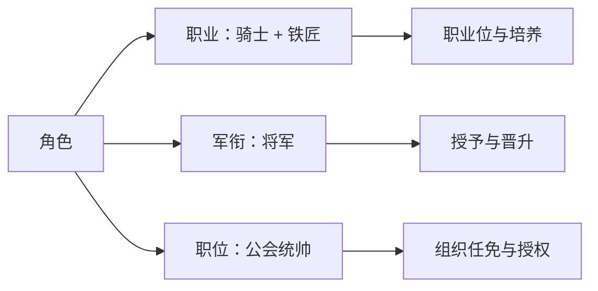

# 职业规则

[角色体系索引](AGENTS.md)

## 建号与职业位

新玩家出生在新手村，初始活动是击杀兔子。角色在建号阶段即可从开放的基础职业中选择主要职业和辅助职业，并立即使用所选职业的能力。完成新手阶段后即可通过适用渠道取得第一个职业资格；资格只代表正式认证。

新手阶段结束需要同时完成并交付新手任务线以及达到 20 级；具体任务内容待定。任务尚未交付时不能结束新手阶段。满足条件后，新手阶段立即结束，角色依据玩家在现实世界的城市级地理位置，被强制传送至游戏世界中对应的最近主城，不能选择继续保留新手身份。完成新手阶段前，角色不能离开新手村及周边练级区域进入外部世界。玩家必须在注册之初提供经政府验证的身份信息；完成身份验证且常住城市已有游戏主城映射，才允许完成注册和登录。缺少城市映射时不能登录，不允许把问题延迟到角色毕业阶段处理。主城匹配优先使用设备提供的实时城市；实时位置不可用时，才回退使用政府验证的常住地址所在城市，两者不进行联合校验。两种位置均不可用时，不能交付最终新手任务，也不能结束新手阶段。不采集用于主城匹配的精确坐标；身份验证渠道、城市映射规则、信息保存范围及合规方案待定。

新手角色持有的非新手特殊任务在强制离开时直接失败。已经离开新手阶段的角色携带特殊任务返回新手区域不受此限制。

已经离开新手阶段的角色可以自由返回新手村及周边练级区域。整个新手村及周边练级区域禁止玩家之间互相攻击，不论角色是否已经完成新手阶段；怪物等非玩家造成的 PvE 伤害不受此限制。

已经完成新手阶段并离开的角色，因死亡掉级至低于 20 级时，直接在距离死亡地点最近的新手村复活，并重新受到新手区域限制。已完成的新手任务保留完成状态，重新达到 20 级即可再次离开新手区域。

- 玩家需要选择职业，通常拥有两个初始职业位。
- 两个初始职业位可以自由组合为"战斗 + 生活"、"战斗 + 战斗"、"生活 + 生活"等；主要职业与辅助职业不固定对应战斗或生活类别。
- 部分特殊职业可能占用多个职业位，具体占用数量由对应职业定义。
- 同一职业进阶沿用原职业位；若进阶后的职业要求更多职业位，再补足差额。
- 职业位不足时，按具体职业或事件分别定义处理方式；进阶、任务奖励与奇遇可以采用不同规则。
- 奇遇或超难任务可以增加职业位。
- 任务、奇遇和特殊奖励可以提供职业获取机会；职业获取条件与职业位扩充条件分别判定。
- 普通角色初期拥有的职业数量有限，理论上允许角色最终拥有大量职业；每增加一个职业，培养成本都会显著上升，体现在各职业的装备、技能、任务等实际投入累积；不额外设置按职业数量增长的统一成本倍率。各职业的具体投入待定义。
- 职业成长采用"基础职业 → 进阶职业 → 高阶职业 → 隐藏职业/特殊职业"的结构，具体职业可以拥有不同的进阶分支和获取入口。
- 建号界面展示当时可以选择的基础职业，不展示隐藏职业的完整名录。隐藏职业发现后如何展示、是否公开取得条件待定。
- 等级只作为部分职业的门槛，不作为统一解锁条件。
- 职业本身不设置独立职业等级、职业经验或职业熟练度；职业进阶通过任务、资格等条件判定，部分职业可以要求角色等级。
- 职业可以通过师承、势力、任务和跨国旅行学习；东方职业不统一限定为 China(CN) 阵营专属。具体职业仍可设定师承或资格要求。
- 魔法、科技、魔导科技、东方术法四套技术路线并存，职业可以围绕不同路线形成分支。
- 主要与辅助职业的能力差异、能否重复选择同一职业及职业更换规则待定。

## 职业获取与资格认证

职业获取与资格取得支持多种同时存在的渠道：

- 普通职业导师：找到导师并完成认证。
- NPC 组织：加入军队、商会、神殿、学院等组织，取得对应职业资格。
- 任务或试炼：完成特定任务或试炼。
- NPC 收徒：被特定 NPC 收为弟子。
- 隐藏资格条件：属性、血统、装备、声望、特殊地点、特定行为、神祇关系等条件参与触发隐藏职业。
- 极少数奇遇：直接赋予特殊职业。

普通职业主要通过导师、组织认证或职业任务取得；特殊与隐藏职业可以通过拜师、奇遇、特殊任务或资格条件取得。任务、NPC 师承、血统、装备、特殊地点、特定行为、神祇关系和奇遇可以共同决定职业获取；同一职业可以存在多种取得方式，也可以要求多个条件同时满足。

进阶结构用于组织成长路线，同时保留特殊任务或极少数奇遇直接授予特殊职业的入口。具体职业是否要求前置职业，由其获取条件决定。

## 职业能力与野技能

- 同一角色可以混合使用已拥有职业的技能，各职业被动能力可同时生效；需满足对应的装备和技能条件，无需切换当前职业。
- 职业自带的技能树较少，主要依靠装备与"野技能"形成不同玩法。
- 同一职业进阶后，已学职业技能和被动能力的保留方式由各条进阶路线分别规定，可以保留、替换或失去。
- 野技能可以跨职业学习，但具体技能可以设置属性、装备、熟练度或特殊资格要求。

## 职业、军衔与职位

职业表示角色掌握的专业能力，例如骑士、铁匠、商人，受职业位与培养规则约束。军衔表示军事等级，例如将军，其授予与晋升规则单独定义。职位表示组织任职，任免与授权按组织规则处理。

职位示例包括公会会长、皇帝、公会统帅、军团长、舰队司令、商会会长、财务官、银行行长、船长、舰长、提督。

一个角色可以同时拥有"职业：骑士 + 铁匠"、"军衔：将军"、"职位：公会统帅"。军衔和职位不占职业位；取得某种职业不自动授予组织职位或指挥权，任职也不自动取得对应职业能力。

军事辅助名录中的军需官、参谋、驯兽军官等名称用于表示专业职业；组织也可以有同名职位，职业能力与职位权限分别判定。经济职业中的商会经营者、银行家、钱庄经营者同样与具体组织的会长、行长等职位分别管理。

完整职业列表见[职业名录与阶位草案](profession-catalog.md)，进阶示例见[职业进阶路线](progression.md)。
