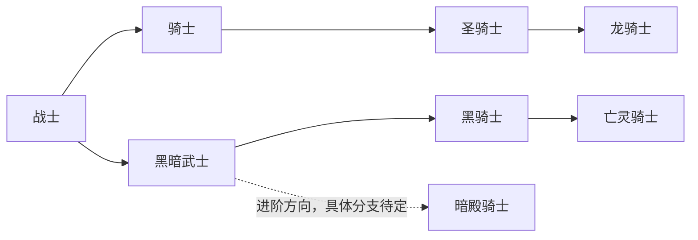
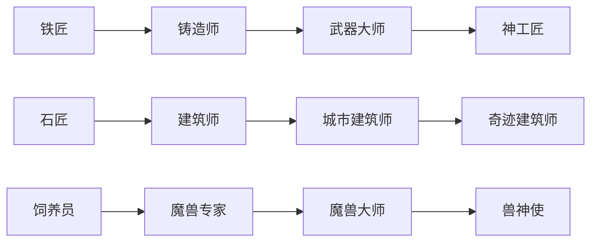
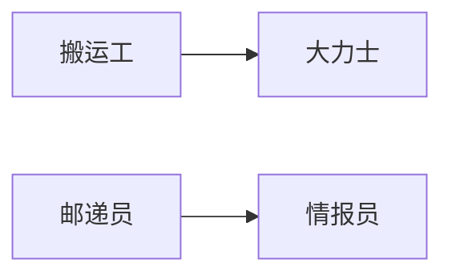

# 职业进阶路线

[角色体系索引](AGENTS.md)

职业成长采用"基础职业 → 进阶职业 → 高阶职业 → 隐藏职业/特殊职业"的结构。以下路线是成长结构示例，职业获取还支持多种入口，具体是否要求前置职业由获取条件决定。

## 战斗职业

骑士方向以战士为基础、骑士为进阶、圣骑士为高阶、龙骑士为隐藏/特殊职业。黑暗战斗方向以战士为基础、黑暗武士为进阶、黑骑士为高阶、亡灵骑士为隐藏/特殊职业。

此前确定的暗殿骑士继续保留为黑暗武士的进阶方向，其与黑骑士、亡灵骑士的具体分支关系待定。图中虚线表示方向已保留，具体分支关系尚未确定。

## 生产与培养职业

下列每条路线从左至右依次表示基础、进阶、高阶、隐藏/特殊职业。

## 后勤职业

"搬运工 → 大力士"与"邮递员 → 情报员"保留为进阶关系。

"石匠 → 建筑师"、"铁匠 → 铸造师"、"饲养员 → 魔兽专家"同时纳入上述生产与培养路线。

## 进阶规则

职业本身不设置独立职业等级、职业经验或职业熟练度。进阶通过对应的任务、资格等条件判定，部分职业可以要求角色等级。

同一职业进阶沿用原职业位。例如，铁匠进阶为铸造师后继续使用原职业位；若进阶后的职业要求更多职业位，再补足差额。

已学职业技能和被动能力的保留方式由各条进阶路线分别规定，可以保留、替换或失去。具体能力清单随对应路线定义。

进阶或直接获得职业时，如果剩余职业位不足，按具体职业或事件分别定义处理方式；进阶、任务奖励与奇遇可以采用不同规则。

## 待定规则

上述路线作为成长结构示例，不是全部路线。各条路线的具体进阶条件、能力清单，以及各职业或事件在职业位不足时采用的具体规则待定义。职业更换、放弃与重新取得后的培养进度规则另行定义。

完整阶位分配见[职业名录与阶位草案](profession-catalog.md)，职业位与获取渠道见[职业规则](professions.md)。
