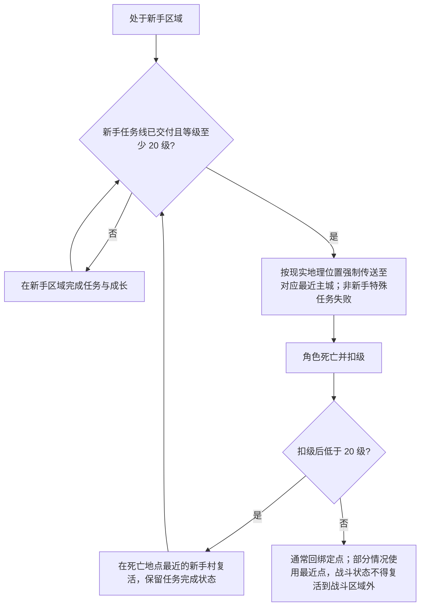

# Demo 范围与技术目标

[设计文档索引](AGENTS.md)

## 平台与引擎

- 正式运行平台为 Windows only，使用键盘和鼠标操作。
- 正式版与初版 Demo 均为 Windows 原生程序。
- 目标引擎为 UE5，具体小版本待定；需要支持后续向 UE6 迁移。

项目以 UE5 为当前目标引擎，将后续迁移到 UE6 作为持续开发目标。迁移依据官方升级路线，并验证职业、战斗、世界状态与资源在升级后的兼容性。Epic 已公布早期 UE6 保留 Actors 和 Blueprints、后续提供框架转换工具的计划；本项目的具体兼容性仍需实际验证。[UE6 官方路线图](https://www.unrealengine.com/news/the-road-to-ue-6)

## 首个可玩里程碑

首个可玩里程碑为基于 UE5 的 Windows 原生新手村 Demo，依次验证建号与职业位选择、新手村出生和杀兔子、拾取与背包，以及死亡和复活。Demo 使用已经明确的职业能力生效、职业位占用、金银铜进位与负重、死亡扣级和复活保护规则。

死亡扣级最低降至 1 级，达到下限后不再降低。

死亡掉落逐件独立判定。金银铜和绑定物品不掉落；魔晶石及其他未绑定物品参与判定，已穿戴物品也包括在内。稀有度越高，单次死亡掉落概率越低，与装备颜色等级无关。累计掉落效果的设计目标见[物品、装备与稀有度](items.md)。

Demo 的职业验证范围包括基础职业的自由组合、多职业技能混用与被动同时生效、职业进阶、占用多个职业位的特殊职业、隐藏职业触发，以及通过奇遇或超难任务获取额外职业位。职业本身不设置独立职业等级、职业经验或职业熟练度。多职业培养需要体现职业数量增加后成本显著上升的规则，成本由各职业的装备、技能、任务等实际投入累积，不额外设置按职业数量增长的统一成本倍率。

首个 Demo 在逐项确定职业阶位后，开放完整基础职业集合，支持"战斗 + 战斗"、"战斗 + 生活"和"生活 + 生活"的组合。进阶、高阶与隐藏/特殊职业通过各自的成长或获取条件取得。首个 Demo 用于验证进阶、特殊职业占位与隐藏职业触发的具体职业，以及各职业的初始能力、获取条件、职业位占用与培养成本待定。

首个 Demo 的镜头参考"逆水寒"与"Genshin"的第三人称形式：可以围绕自己的角色转动观察，但不能脱离角色自由移动。

首个 Demo 各职业的初始能力与具体参数、兔子的战斗和掉落参数、初始装备与财物、运行和验证设备待定。首个开发里程碑与正式首版的多国覆盖目标分别制定；世界与战场的模拟方式及整体承载能力仍需后续验证。

## 新手阶段完成条件

新手阶段结束需要同时满足以下条件：

- 完成并交付新手任务线，具体任务目标、数量与奖励待定；任务尚未交付时不能结束新手阶段。
- 角色等级达到 20 级。

完成新手阶段前，角色不能离开新手村及周边练级区域进入外部世界。同时满足上述条件时，新手阶段立即结束，角色依据玩家在现实世界的城市级地理位置，被强制传送至游戏世界中对应的最近主城，不能选择继续保留新手身份。玩家必须在注册之初提供经政府验证的身份信息；完成身份验证且常住城市已有游戏主城映射，才允许完成注册和登录。缺少城市映射时不能登录，不允许把问题延迟到角色毕业阶段处理。主城匹配优先使用设备提供的实时城市；实时位置不可用时，才回退使用政府验证的常住地址所在城市，两者不进行联合校验。两种位置均不可用时，不能交付最终新手任务，也不能结束新手阶段。不采集用于主城匹配的精确坐标；身份验证渠道、城市映射规则、信息保存范围及合规方案待定。

新手角色持有的非新手特殊任务在强制离开时直接失败。已经离开新手阶段的角色携带特殊任务返回新手区域不受此限制。

已经离开新手阶段的角色可以自由返回新手村及周边练级区域。整个新手村及周边练级区域禁止玩家之间互相攻击，不论角色是否已经完成新手阶段；怪物等非玩家造成的 PvE 伤害不受此限制。

已经完成新手阶段并离开的角色，因死亡掉级至低于 20 级时，直接在距离死亡地点最近的新手村复活，并重新受到新手区域限制。已完成的新手任务保留完成状态，重新达到 20 级即可再次离开新手区域。

已离开新手区域、死亡后仍为 20 级及以上的角色，通常在预先绑定的复活点复活；部分情况下使用最近的复活点。战斗状态下，复活地点不得离开战斗区域。

战斗状态下，绑定的复活点在战斗区域内时优先使用绑定点；绑定点在区域外时，使用战斗区域内距离死亡地点最近的可用复活点。

完成新手阶段后，可以通过适用渠道取得第一个职业资格；资格只代表正式认证，职业能力已在建号选择职业后生效。

## 首轮验证顺序

以下箭头表示首轮体验的验证顺序：

职业规则见[职业规则](characters/professions.md)，建号候选名单见[职业名录与阶位草案](characters/profession-catalog.md)，数值与惩罚见[战斗、成长与死亡](characters/growth-and-death.md)，背包中的货币规则见[经济与建设](economy.md)。

## 规模与承载目标

规模目标与待验证内容如下：

| 项目 | 目标或状态 |
| --- | --- |
| 单个战场真实玩家 | 1,000 人以上同时交战 |
| 全世界总在线人数 | 另行确定 |
| NPC 军队 | 存在 100,000 名以上的军队目标，采用共享、分层授权的指挥方式 |
| NPC 数量统计 | 按实际军队与部队统计，不能按参战玩家人数直接倍乘 |
| NPC 模拟 | 单场总兵力、独立实体与部队结算的粒度、可见数量、寻路与碰撞要求待定 |
| 容量验证 | 需要验证真人即时动作与 NPC 部队共同参战时的承载能力，现有数字不代表已经实现的能力 |

## 下一步

基于已有[职业名录与阶位草案](characters/profession-catalog.md)，继续明确基础职业的初始能力，以及各条进阶路线的具体能力清单。职业进阶已确定沿用原职业位，进阶职业要求更多职业位时补足差额；已学职业技能和被动能力按进阶路线分别保留、替换或失去。职业位不足时按具体职业或事件分别处理，各项具体规则待定义。

在这些规则明确后，继续细化新手任务线、兔子的战斗与掉落参数、初始装备与财物、其他情况下的复活位置、运行和验证设备，再安排首个 Demo 的实现。
