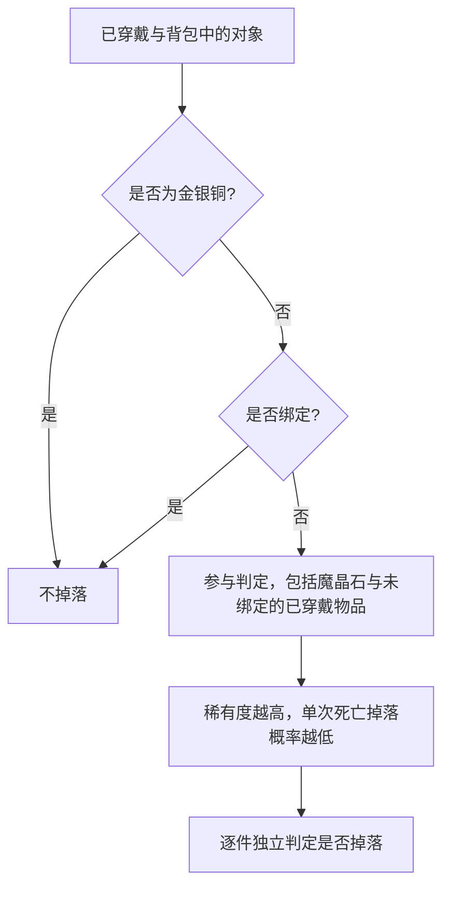

# 物品、装备与稀有度

[设计文档索引](AGENTS.md)

## 死亡掉落范围

- 金银铜不掉落。
- 魔晶石参与物品掉落判定。
- 绑定物品不掉落，包括强制绑定的特殊装备。
- 未绑定物品参与掉落判定，已穿戴物品也包括在内。
- 每件符合条件的物品独立判定是否掉落，一次死亡可能掉落多件。

死亡扣级、复活与保护规则见[战斗、成长与死亡](characters/growth-and-death.md)。

## 稀有度与颜色等级

每件装备都有自身的稀有度。死亡掉落概率与物品自身的稀有度有关，与装备颜色等级无关。

物品自身的稀有度由设计预设，全服存量等变化不会自动改变稀有度或由此得到的死亡掉落概率。

稀有度越高，单次死亡掉落概率越低，但整体掉落难度不高。

累计掉落效果的设计目标以默认每次死亡扣 1 级为基准：1000 级角色被持续击杀到低于 20 级、返回新手村时，可掉落物品应基本掉光。该目标适用于参与掉落判定的物品；金银铜与绑定物品不掉落。

特殊扣级使死亡次数减少时，不要求达到同等累计掉落程度；例如，每次扣 100 级、约 10 次死亡就返回新手村的情况不适用上述累计目标。

各物品的预设稀有度与具体概率数值待定。

## 绑定与唯一内容

普通装备不存在绑定设定；特殊装备可以强制绑定。

世界中存在全服唯一套装，以及只能由一名玩家执行的任务等特殊内容。此类内容对应的特殊装备通常强制绑定，适用绑定物品不掉落的规则。

唯一内容的名额如何锁定、取得资格如何判定，以及绑定对交易、丢弃等行为的影响待定。

## 神器与国器

- 部分极难获取的神器可以转化为全球唯一的"国器"；系统也可能直接发放特殊国器。
- 通常在公会阶段结束后，国家最大公会会长身上已经装备的神器自动转化为国器；另一种入口是系统向该国最大公会会长发放特殊国器。
- 国器可以无视所有复活固定提供的 3 秒无敌保护，对刚复活的角色产生效果。
- 国器的具体数量、转化条件、系统发放条件、效果、所有权转移、掉落与绑定规则待定。
