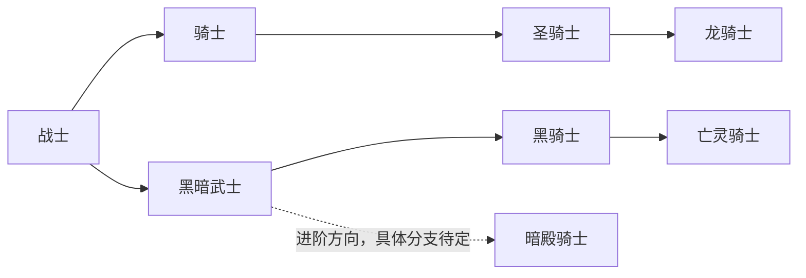
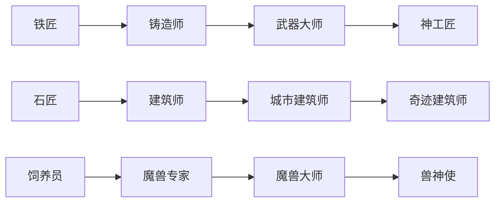
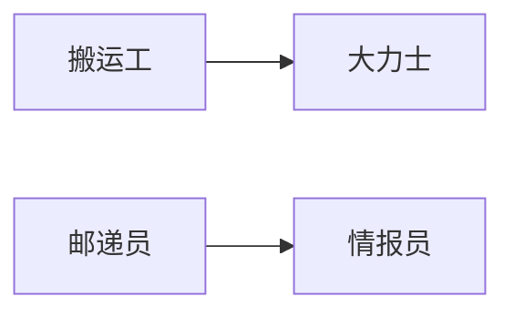

# 职业规则

[角色体系索引](AGENTS.md)

## 职业位与培养

| 类别 | 初始职业位 | 后续扩充位置 | 扩充任务难度 |
| --- | --- | --- | --- |
| 战斗职业 | 1 个主职业位 | 副职业位 | 非常难 |
| 生活职业 | 1 个主职业位、2 个副职业位 | 副职业位 | 比较难 |

战斗和生活职业各用各的职业位，按各自任务单独扩充，任务获取和完成难度不能改。数量是“(1 + 战斗扩充数量) + (3 + 生活扩充数量)”，两边分开算。

- 主、副职业完全平等，同一职业放在哪种职业位，能力都一样。
- 同一角色不能重复选择同一职业，例如同时选择两个战士或两个铁匠。
- 部分特殊职业可能占多个职业位，占几个按职业定。
- 职业位不够时，看职业或事件怎么规定；进阶、任务奖励和奇遇可以各有规则。
- 奇遇或超难任务可以增加职业位。
- 任务、奇遇和特殊奖励都可能给职业获取机会；拿职业和扩职业位的条件分开判断。
- 普通角色初期职业有限，后期理论上可以有很多职业。每多一个职业，装备、技能、任务等实际投入都会累加，培养成本明显增加；不按职业数量额外加统一倍率。各职业需要多少投入还没定。
- 已取得的职业不能主动放弃，也不能腾出职业位换职业。

## 职业获取与资格认证

建号时，从开放的基础职业里，按战斗和生活职业位选职业，能力立即生效。完成[新手阶段](新手历程.md)后，就能通过相应渠道拿第一个职业资格；资格只代表正式认证。

- 建号界面只展示当时能选的基础职业，不展示完整隐藏职业名录。隐藏职业信息由玩家自己保密或传播，系统不发公告；这条可以随内容设计调整。
- 只有部分职业有等级门槛，不统一按等级解锁。
- 职业可以通过师承、势力、任务和跨国旅行学习。东方职业不统一限制为 China(CN) 阵营专属，各职业可以有自己的师承或资格要求。
- 魔法、科技、魔导科技、东方术法四套技术路线并存，职业可以围绕不同路线形成分支。

职业和资格可以通过多种渠道取得：

- 普通职业导师：找到导师并完成认证。
- NPC 组织：加入军队、商会、神殿、学院等组织，取得对应职业资格。
- 任务或试炼：完成特定任务或试炼。
- NPC 收徒：被特定 NPC 收为弟子。
- 隐藏资格条件：属性、血统、装备、声望、特殊地点、特定行为、神祇关系等条件参与触发隐藏职业。
- 极少数奇遇：直接赋予特殊职业。

普通职业主要靠导师、组织认证或职业任务取得；特殊和隐藏职业可以靠拜师、奇遇、特殊任务或资格条件取得。任务、NPC 师承、血统、装备、特殊地点、特定行为、神祇关系和奇遇都可以参与判定。同一职业可以有多种获取方式，也可以要求同时满足多个条件。

特殊任务或极少数奇遇可以直接给特殊职业。是否需要前置职业，看该职业的获取条件。

## 职业能力与野技能

- 已拥有职业的技能可以混用，被动可以同时生效，只要满足各自的装备和技能条件，不用切换职业。
- 职业自带技能树较少，玩法主要靠装备和“野技能”搭配。
- 野技能可以跨职业学习，各技能可以要求属性、装备、熟练度或特殊资格。

## 进阶规则

职业按“基础职业 → 进阶职业 → 高阶职业 → 隐藏职业/特殊职业”组织成长路线，各职业可以有不同分支和获取方式。

职业没有独立等级、经验或熟练度。进阶看任务、资格等条件，部分职业可以要求角色等级。

进阶沿用原职业位，比如铁匠进阶为铸造师；进阶职业占位更多时，再补差额。

已学职业技能和被动是保留、替换还是失去，按各条进阶路线定，能力清单也由各路线决定。

理论上可以做任务换进阶分支，路线和条件看后期任务设计。玩家必须接到并完成任务，不保证每个人都能接到。

## 进阶路线

以下是路线示例，完整路线从左到右依次是基础、进阶、高阶、隐藏/特殊职业。各路线的进阶条件、能力清单，以及职业位不够时怎么处理，都还没定。

### 战斗职业

暗殿骑士是黑暗武士的进阶方向，与黑骑士、亡灵骑士怎么分支还没定，图中用虚线表示。

### 生产与培养职业

### 后勤职业

## 职业、军衔与职位

职业是专业能力，比如骑士、铁匠、商人，要占职业位，也要培养。军衔是军事等级，比如将军，授予和晋升另定。职位是组织任职，任免和授权看组织规则。

职位示例包括公会会长、皇帝、公会统帅、军团长、舰队司令、商会会长、财务官、银行行长、船长、舰长、提督。

同一角色可以是骑士加铁匠，同时有将军军衔、担任公会统帅。军衔和职位不占职业位；拿到职业不会自动获得职位或指挥权，任职也不会自动获得职业能力。

军需官、参谋、驯兽军官等在名录里是职业，组织也可以有同名职位，能力和权限分开算。商会经营者、银行家、钱庄经营者也与会长、行长等职位分开。

完整职业列表与阶位分配见[职业名录](../../auto-calc-rules/职业名录.md)。
