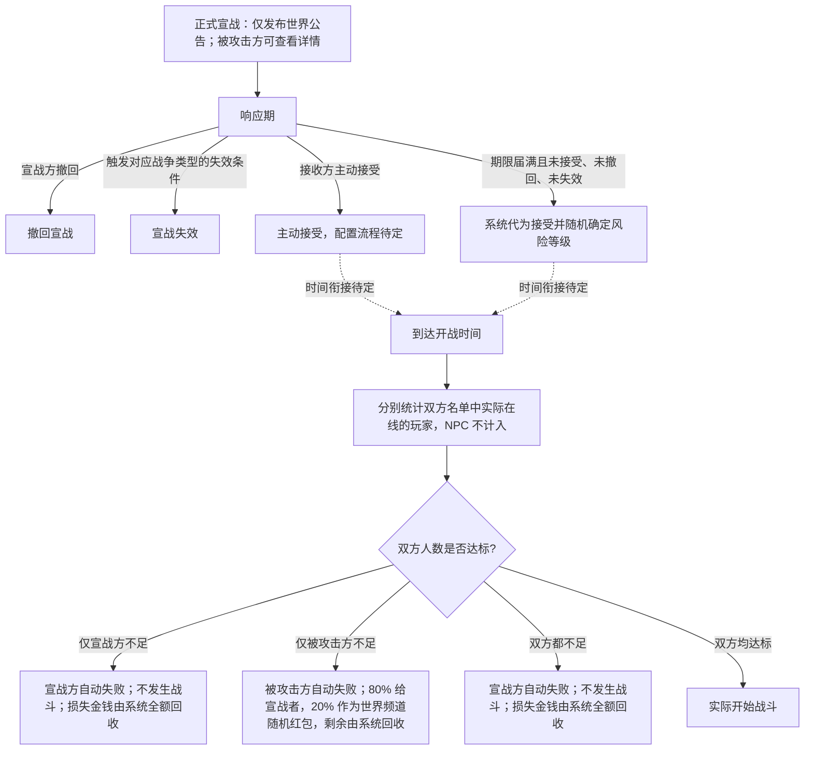

# 战争与城池

[世界与组织索引](AGENTS.md)

## 战争类型与规则

战争类型分为公会战、城市战与国家战；小战和大战表示人数规模。各战争类型可用的规模组合待定。

- 大部分世界允许高风险冲突，长期积累的装备、建筑与领地也可能失去。
- 全天候可以进攻，玩家离线不会使其领地和建筑停止参与世界运行。
- 正式宣战发出时，除发布世界公告外不产生其他即时效果，也不会使任何角色进入战斗或离线留场状态。被攻击方可以随时查看宣战的具体详情。
- 正式宣战具有响应期限，接收方不主动接受也不能无限期阻止战争生效。
- 响应期内，宣战方可以撤回宣战。
- 战争类型决定宣战失效条件的组合，判定涉及实际发起人或公会会长被杀至 20 级或以下，以及开战时的参战人数是否达标。各类型的具体组合，以及响应期限与开战时间的衔接待定。
- 任何人均可以执行上述击杀，不要求属于宣战接收方。击杀相关玩家需要相应的战斗投入与资源消耗。
- 战前勾选参战玩家，离线成员也可以先选入并被要求按时上线。
- 双方均需预缴战争保证金。宣战方在发起宣战时预缴；被攻击方在主动接受或系统自动接受时预缴。宣战方保证金不足时不能发起宣战；被攻击方主动接受时保证金不足时不能完成主动接受。
- 响应期届满并触发系统自动接受时，如果被攻击方组织账户不足以缴纳保证金，系统按系统价格随机回收被攻击方集体所有且不属于玩家个人的道具，以回收价值补足保证金。系统持续随机回收，直到保证金足额，或所有符合条件的道具都已回收；不按玩家市场价格估值，也不回收玩家个人道具。
- 集体道具全部回收后保证金仍不足时，被攻击方立即失败，不再进入开战人数检查或实际战斗；受攻击城池直接丢失。
- 所有失去城市的情况均执行败方迁移。失城后仍有己方城市时，被攻击方全体成员分别强制传送至按游戏世界地图计算、距离失守城池最近且仍由被攻击方控制的城市。
- 失去的是公会最后一座城市、但不是所属国家最后一座城市时，被攻击方成员传送至该国最大公会的主城。最大公会的判定标准待定。
- 失去的是国家最后一座城市时进入限期复国阶段。复国期限为现实时间 7 天，从最后一座城市失守的判定时刻开始连续计算；服务器维护、故障、玩家离线或网络异常均不暂停、不顺延。在期限内重新取得至少一座城市，即视为复国。项目不以野外据点、领土格或零散土地作为复国判定单位。
- 国家最后一城失守后，原国家全体玩家统一传送到刚刚失守并已归战胜国控制的城市外，在正式世界中组织复国。强制传送落地后获得 3 秒无敌；角色在保护期内发起敌对行为时立即取消无敌，不等待命中或伤害结算。只有 7 天期限届满仍未取得城市时，才被送入流放地。
- 限期内未能夺回任何国土时，系统判定侵略成功，取消原国家国籍。该国玩家账号不封禁，仍可正常登录并继续游戏；角色国籍栏改为显示"流放者"，不会自动取得战胜国国籍。
- 侵略成功后，原国家玩家被强制送往不在正式地图上的特殊区域"流放地"。
- 侵略成功后仍可复国。任意一名原国家流放者成功恢复原国家时，所有仍属于该原国家的流放者一并恢复原国籍和身份；已申请并获准加入其他国家的玩家已经与原国家脱离，不随原国家恢复。
- 流放者对正式地图目标的宣战正式生效后，才能从流放地进入正式地图；发出公告和响应期内均不能进入。宣战撤回或失效时不开放入口。
- 在战斗开始时间，按参战名单中实际在线的玩家人数分别检查双方是否达标；小战每方至少 20 人，大战每方至少 1,000 人。
- 仅宣战方人数不足时，宣战方自动失败，不会实际发生战斗；宣战方损失的金钱由系统全额回收。
- 仅被攻击方人数不足时，被攻击方自动失败，不会实际发生战斗。被攻击方因此损失的金钱中，80% 进入宣战者账户，20% 形成发布在世界频道的随机红包。只有开战人数检查时实际在线且已列入参战名单的宣战方成员可以抢取，每人最多抢取 1 次，单次取得的金额随机；未主动抢取视为放弃，不自动补发。抢取资格在开战人数检查时锁定，符合资格者中途掉线后，只要在红包截止前重连，仍可抢取。红包开放 1 分钟，到期立即关闭，仍未被抢取的余额由系统回收。人数检查时离线者和未列入参战名单者不能抢取。
- 双方人数都不足时，宣战方自动失败，不会实际发生战斗；宣战方损失的金钱由系统全额回收。
- 双方人数均达标时才实际开始战斗。
- NPC 军队不计入上述人数，也不设置额外等级等参战资格限制。在线状态如何与离线后仍留在世界中的角色关联，待定。
- 发起战斗除战争保证金外是否另收费用待定。保证金的币种、金额计算方式，以及除已明确人数不足场景外的返还与资金结算规则待定。
- 接收方尚未主动接受、响应期届满，且宣战未撤回、对应的宣战失效条件也未触发时，系统以接收方会长的游戏内权限自动接受。
- 自动接受时随机确定多种风险等级；具体类型、取值范围及分布待定。
- 主动接受时的配置流程、正式战争与偷袭的衔接、战争持续时间及终止条件待定。
- 敌对行为尝试会把战斗离线倒计时刷新为 2 分钟。攻击、控制或敌对施法一旦以该角色为作用目标，即使未命中、被闪避、格挡、免疫或最终没有造成伤害，也会刷新倒计时；单纯环境伤害与自身反噬不刷新。
- 未直接选中角色的范围攻击，只要使该角色进入敌对效果的命中判定，也会刷新倒计时；不要求最终造成伤害或控制。
- 任何依照当前世界规则实际具备伤害该角色权限的玩家、NPC、怪物、召唤物或机关，其敌对行为都可以触发倒计时刷新；不要求双方存在正式宣战关系。
- 倒计时内关闭客户端或断网，角色仍留在世界中并可被攻击。倒计时结束时，仍存活且未被新的敌对行为尝试刷新倒计时的角色立即安全下线并从世界移除，不传送到其他位置。
- 同一账号通常不能同时操控两个角色。切换角色时，仍受战斗离线倒计时约束的原角色会保留战斗状态，暂由系统作为受限 NPC 留场并可被攻击；玩家可以登录另一个角色，但不能同时控制原角色。
- 离线留场角色原地不动，系统不会替其防御、闪避、施放技能、使用道具、逃跑或反击；装备与已经生效的被动效果继续按正常规则结算。
- 玩家可以退出当前角色并立即重新接管仍在倒计时内的原角色；接管后恢复完整操作，不必等待倒计时结束。同一账号仍始终只能有一个由玩家操控的角色。

## 宣战与开战人数检查

下图整理已经明确的响应与检查规则。虚线表示接受宣战与开战时间之间尚待定义的衔接；人数达标表示通过人数检查。

## 偷袭、主城与迁都

城池保护与迁都采用以下规则：

- 允许偷袭，但主城不能成为偷袭目标。
- "最后一城"分别按公会和国家计算，两种范围下的最后一城均不能被偷袭。
- 主城与最后一城不必是同一座城。
- 初始主城以既定首都为基础，玩家可以迁都。
- 主城毁坏后，其他城市仍可存在。
- 玩家可以通过战争或金钱收回主城，也可以选择迁都。
- 迁都条件、保护转换的生效时间、已经开始的偷袭或攻城如何处理，尚未定义。
